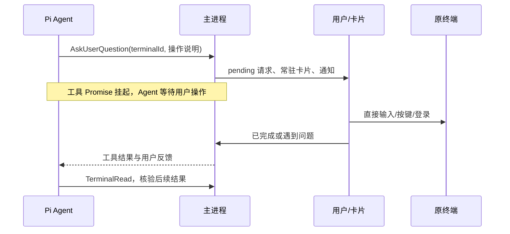

# v1.17.4 终端用户接管开发规格

- 文档版本：1.0.0
- 日期：2026-10-14
- 状态：实现完成，本地核心验证通过，待发布流水线和资产验收
- 读者：Proma 开发者与发布维护者
- 基线：`97631d7030765f70bfc25ee9ee7390ee3fc5a87d` / v1.17.3

## 问题与目标

`TerminalExecute` 向可见终端写入命令后立即返回；PTY 的存活不代表命令完成或不需要输入。模型结束一轮后，聊天只剩耗时与折叠过程，用户看不出终端仍需操作。

本版让模型主动请求用户接管终端，展示不会藏进执行过程的交互卡片；用户在原终端完成操作并回复卡片后，同一挂起工具返回，原 Agent 自然续跑并核验终端结果。卡片反馈不向 stdin 写入内容。

同时修复两个阻断闭环的问题：renderer 重载只恢复计划审批，遗漏问答与权限；PTY 输出 ACK 依赖终端视图，隐藏标签后输出与退出可能滞留。

## 范围与取舍

- 复用 `AskUserQuestion`、既有 pending 服务、IPC、Jotai 和通知，不新增依赖或通用交互平台。
- 增加可选 `terminalId`，普通问答保持兼容。模型读到需用户输入、登录、确认的提示后，必须调用该工具；不能只说“等待你操作”便结束回复。
- 本版不根据无输出时长自动断言 stdin 等待，不实现通用终端提示识别或 shell 命令完成检测。模型未调用工具仍可能漏报，这是明确限制。
- 不自动输入密码，不把卡片反馈解释为安装/登录/部署成功；用户声明完成后仍须 `TerminalRead`。
- 不持久化密码与 pending Promise；renderer 重载可恢复主进程内存请求，整个应用退出后不会假装恢复同一个运行实例。

## 工具与跨进程契约

模型调用示例：

```json
{
  "terminalId": "当前会话终端 ID",
  "questions": [{ "question": "请在此终端完成安装确认，操作完毕后点击已完成，继续。" }]
}
```

主进程必须校验 terminalId 格式、当前会话所有权、终端仍存活；终端接管只接受一个非空操作说明，禁止绑定其他会话终端。问题和反馈均有长度界限；不相信模型传入的 answers 或结果。

`AskUserRequest` 增加可选 `terminal: { terminalId, title }`，由主进程填充。`AskUserResponse` 增加可选 `terminalResponse: { outcome: 'completed' | 'problem', message?: string }`，普通 answers 仍保留以兼容既有 bridge/collaboration 调用。

工具结果包含原 answers，以及主进程生成的 `terminalInteraction: { terminalId, outcome: 'completed' | 'problem' | 'unavailable', message? }`。`completed` 仅代表用户完成操作；结果明确要求下一步读取输出。老 bridge 使用固定“已完成，继续”选项时可映射 completed，其余反馈为 problem。

回复走既有 ASK_USER_RESPOND，主进程验证请求和 payload；过期请求明确报错，UI 不伪装提交成功。所有权/请求 ID 与终端 ID 的绑定由主进程保证。终端关闭或退出返回 unavailable；停止 Agent 通过 AbortSignal 解除等待，不另启动 Agent。

## 状态与界面



卡片展示“等待你操作终端”、操作说明、目标终端名称、“打开终端”“已完成，继续”“遇到问题”“取消任务”。问题反馈可填写可选说明，提交期间禁用重复操作，失败显示就地错误且保留内容。取消明确停止 Agent，不假装中断了终端程序；用户可进入终端手动 Ctrl+C。

点击打开终端只定位所属会话既有标签并聚焦 xterm，不能创建新终端。没有抢占其他会话的自动聚焦。保留键盘 Tab/Enter 操作、主题变量、可访问名称和状态播报；普通问答的全局上下键监听不应吞掉终端输入。

消息底部根据当前会话 pending 显示“等待你操作终端”/“等待你的回答”/“等待权限确认”/“等待计划审批”，替换 Agent Running，不改变真实 running 或把等待标为完成。会话导航沿用既有 blocked 状态，恢复后无 running 快照时 pending 仍优先标为 blocked。

## 生命周期与恢复

- 登记 pending 后才发布请求，避免同步回复找不到请求。
- 监听器先注册，再读取 pending 快照；问答/权限按 requestId 去重，记录恢复期间已解决 ID，避免迟到快照复活请求。计划审批沿用现有实现。
- 回复、AbortSignal、终端退出/关闭均只结算一次；移除 abort 监听器并广播 resolved，使卡片与状态消失。已中止 signal 不登记请求。
- 终端接管的 capability RPC 不套用普通问答的 15 分钟超时；用户未完成操作时持续等待，由回复、取消或终端消失收束。其他问答/能力超时保持现有策略。
- Terminal 服务在输出进入有限主进程缓冲后 ACK。xterm 不再承担 runtime 流量确认，仍以 sequence 与 snapshot 去重恢复。缓冲上限保留，后台输出不会无限占内存。
- terminal-runtime 异常退出也应收束终端记录与未决接管，不能永远 running。
- Automation/协作/外部 bridge 维持既有交互授权边界；旧问答、权限、计划模式不回退。

## 实施文件与顺序

1. shared Agent 请求/响应类型、版本：兼容的可选终端字段。
2. `agent-ask-user-service`、orchestrator、Pi 工具与 prompt：校验、挂起、结果、终端不可用与 abort 收尾。
3. terminal service/runtime client：主进程 ACK、异常退出通知；preload/main IPC 检查响应契约。
4. renderer pending 恢复、导航状态、消息等待文案、接管卡片、终端聚焦。
5. BDD 回归、浏览器与真实 ConPTY 冒烟、版本/发布说明，审查后提交与发布。

## 验收标准

| Given / When | Then |
|---|---|
| 合法终端接管请求，用户尚未回复 | 工具不返回，常驻等待卡片与 blocked 状态可见 |
| 用户在终端操作后点击已完成 | 原工具返回 completed，Agent 读取输出，不将声明直接视为成功 |
| 用户遇到问题 | 返回 problem 与说明，不自动向 stdin 写入 |
| 请求其他会话/已退出终端 | 拒绝绑定，无 pending 残留 |
| signal 预先或随后 abort、终端关闭/退出 | 等待解除，resolved 单次，卡片消失 |
| 切标签、收起终端、持续输出 | 主进程继续收到输出，TerminalRead 与 exit 不依赖视图 |
| renderer 重载，快照与请求/解决事件乱序 | 请求只出现一次，已解决请求不复活 |
| 普通问答/权限/计划审批 | 原流程保持兼容；输入焦点和取消正确 |
| 重复点击或 IPC 失败 | 无重复续跑，保留卡片/反馈并明确显示错误 |

先运行最小相关 BDD，再 `bun run typecheck`、全量 `bun test`、`bun run electron:build`、renderer 边界/产物与 MCP bundle 冒烟。Windows 发布前用真实 Electron/node-pty 运行交互小程序，覆盖分段提示、输入后输出、隐藏视图无 ACK 和退出；CI 目标平台打包均成功。

## 发布与回退

- Electron 1.17.3→1.17.4；shared 0.12.4→0.12.5；私有根版本与交付版本对齐为 1.17.4。
- 保留所有用户原有未提交内容，只提交本批明确文件；开发规格纳入本批提交。
- 推送 main 与 annotated v1.17.4 tag，等待既有 Release workflow 产出各平台包。Release 保持 draft，验证 CI、15 项资产及三份更新清单的版本/引用/摘要后公开为 Latest。
- 不覆盖已有 tag 或资产。失败先修复并重跑可重跑步骤，不能把未验证草稿公开。
- 若发布后回归，停用该版分发并发布递增 patch 修复；不删除用户会话、不回滚配置数据。

## 实施与验收记录

- 实现：扩展既有 AskUserQuestion；终端接管卡片、结构化反馈、等待文案、归属验证、退出/取消收尾、问答/权限重载恢复、主进程输出 ACK、终端接管无自动超时均已落地。
- 本地验证：804 项测试 / 0 fail，134 个文件；workspace typecheck、frozen lockfile、Electron build、443 个 renderer 源文件边界与 864 个产物文件检查、MCP Local/Public CJS/Electron 冒烟通过。
- 真实终端：Electron 43.2.0 + Windows ConPTY，验证无 renderer ACK 时交互输入后的连续输出、终端关闭解除接管和跨会话归属拒绝。
- 界面验证范围：真实组件静态渲染测试通过，覆盖接管/普通问答、草稿恢复、可访问标签、反馈长度、无运行快照的等待状态及导航 blocked。没有把静态测试描述为点击或视觉验收。
- 界面验收限制：Edge 扩展通道未连接；自动审批审查拒绝命令行驱动 Electron 界面测试，返回 blocked by policy，未提供更具体原因。未完成实际点击、截图、深浅主题和窄布局实测。
- 发布：Windows 本地打包及各平台 CI、资产/更新清单验收的实际结果记录在本批 TASK_STATE；公开 Release 前必须完成这些检查。
